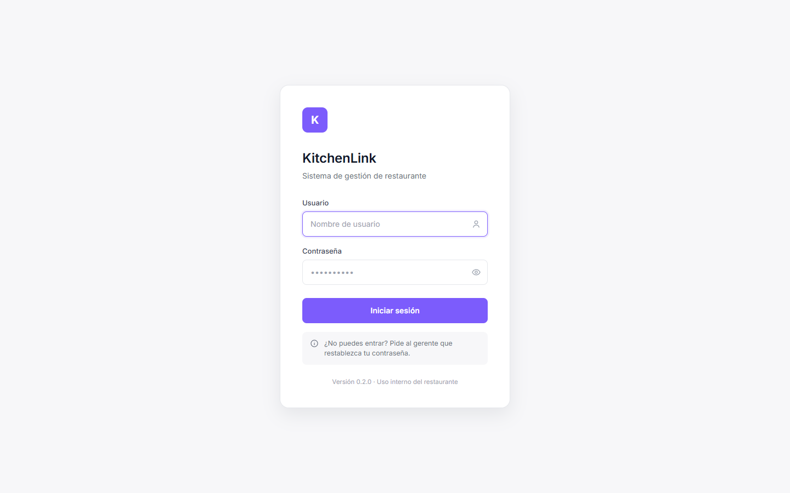
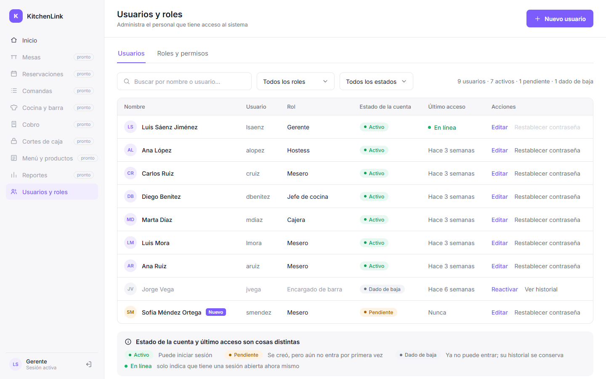
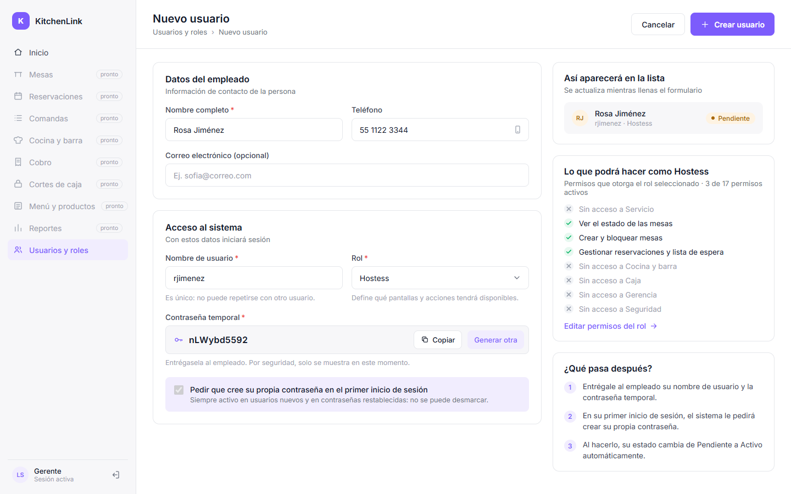
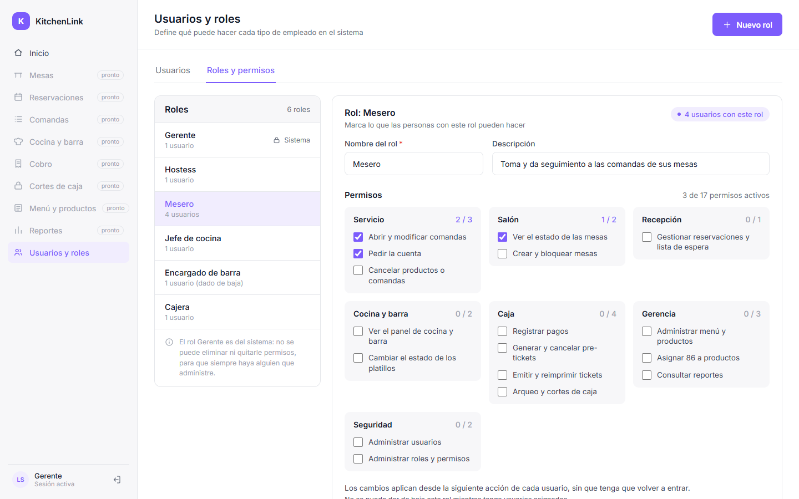

# KitchenLink

[](https://github.com/Remaori/Kitchenlink/actions/workflows/pruebas.yml)
[](CHANGELOG.md)


Sistema de gestión para restaurantes que funciona dentro de la red local del restaurante. Los dispositivos
(tablets, pantallas y computadoras) se conectan a un servidor propio, así que la operación no depende de
internet.

**React · Node.js + Express · PostgreSQL**

## Funcionalidades

**Seguridad y accesos**

- **Inicio de sesión** con usuario y contraseña. Un mismo mensaje para usuario inexistente y contraseña
  incorrecta (no revela qué cuentas existen) y bloqueo temporal tras varios intentos fallidos.
- **Cambio de contraseña obligatorio** en el primer inicio de sesión y cuando el gerente la restablece.
- **Usuarios:** alta con contraseña temporal, edición, restablecimiento de contraseña, baja y reactivación
  (la baja conserva el historial de la cuenta), búsqueda y filtros por rol y estado.
- **Roles y permisos:** 17 permisos agrupados por área (servicio, salón, recepción, cocina y barra, caja,
  gerencia y seguridad). Se crean roles y se marcan sus permisos; los cambios aplican desde la siguiente
  acción de cada usuario. El rol Gerente es del sistema: no se le quitan permisos ni se da de baja.
- El menú y las pantallas de cada persona se arman con los permisos de su rol.

**Modelo de datos**

La base de datos (19 tablas, 22 vistas y 27 triggers) cubre la operación completa del restaurante: menú,
mesas, reservaciones y lista de espera, comandas, cocina y barra, cobro, cortes de caja y bitácora. Los
módulos de la aplicación que usan esas tablas se integran por etapas.

## Capturas

| Inicio de sesión | Usuarios |
|---|---|
|  |  |
| **Nuevo usuario** | **Roles y permisos** |
|  |  |

## Arquitectura

```
Dispositivos del restaurante (navegador)
        │  HTTPS · red local
        ▼
      Nginx ──── app React compilada
        │
        └── /api ──► Express (127.0.0.1:3000) ──► PostgreSQL
```

- La API solo escucha en el propio servidor; los dispositivos llegan a ella a través de Nginx.
- Las reglas del negocio también viven en la base (triggers): si alguien se salta la aplicación, la base
  rechaza la operación.
- La aplicación se conecta a PostgreSQL con un rol de permisos mínimos: no puede borrar tablas ni modificar
  la bitácora, los pagos o las cancelaciones.
- Sin recursos externos: la fuente y los íconos van dentro de la aplicación.

**Seguridad**

- Contraseñas con bcrypt; nunca se guardan en claro.
- Sesión con JWT en una cookie `HttpOnly` y `SameSite=Strict`. Cada sesión tiene una fila en la base, así
  que cerrar sesión o dar de baja a un usuario corta su acceso al instante.
- Los permisos se revisan en la API y otra vez en la base.
- La bitácora registra altas, bajas, cambios de rol y restablecimientos de contraseña, con quién y cuándo.

Diagramas y detalle en [docs/ARQUITECTURA.md](docs/ARQUITECTURA.md).

## Instalación

Requisitos: Node.js 24 LTS (mínimo 20.19), PostgreSQL 16 o superior y Git.

```bash
npm install
npm run env:crear      # crea backend/.env; después escribe DB_ADMIN_PASSWORD (contraseña de postgres)
npm run db:instalar    # crea la base kitchenlink con el esquema y datos de demostración
npm run dev            # API en :3000 y la aplicación en http://localhost:5173
```

La guía paso a paso (Windows y Ubuntu, acceso desde otros equipos de la red local y Nginx con HTTPS) está en
[docs/GUIA_ENTORNO.md](docs/GUIA_ENTORNO.md).

### Datos de demostración

`npm run db:instalar` carga un restaurante de ejemplo con su personal:

| Usuario | Contraseña | Rol |
|---|---|---|
| `lsaenz` | `Kitchen2026` | Gerente |
| `smendez` | `Temporal2026` | Mesero recién dado de alta: al entrar pide crear su contraseña |

Los demás usuarios están en [database/README.md](database/README.md). Para una instalación real:
`npm run db:instalar -- --sin-demo` y después `npm run usuario:gerente -- <usuario> "<Nombre>"`.

## Comandos

| Comando | Qué hace |
|---|---|
| `npm run dev` | API y aplicación en este equipo |
| `npm run dev:red` | Igual, y la aplicación se abre desde otros equipos de la red local |
| `npm test` | Pruebas automáticas (usan la base `kitchenlink_pruebas`) |
| `npm run build` | Compila la aplicación para Nginx (`frontend/dist`) |
| `npm run db:instalar [-- --recrear \| --sin-demo]` | Crea o actualiza la base |
| `npm run db:conectividad [-- --api URL]` | Verifica la conexión API ↔ PostgreSQL y genera un reporte |
| `npm run usuario:gerente -- <usuario> "<Nombre>"` | Primer gerente de una base vacía |
| `npm run usuario:restablecer -- <usuario>` | Contraseña temporal nueva desde el servidor |

## Pruebas

- `npm test`: 71 pruebas automáticas (node:test + supertest) sobre una base aparte. Cubren la conexión y los
  permisos mínimos, el inicio de sesión y las sesiones, los roles y los usuarios, incluidas peticiones que
  llegan al mismo tiempo.
- `npm run db:conectividad`: 24 verificaciones de la conexión entre la API y PostgreSQL.
- La validación de los casos de uso de seguridad, con capturas de cada caso, está en
  [docs/PRUEBA_TEMPRANA_VALIDACION.md](docs/PRUEBA_TEMPRANA_VALIDACION.md).

## Estructura

```
kitchenlink/
├── backend/            API REST · Node.js + Express
│   ├── src/
│   │   ├── seguridad/  inicio de sesión, sesiones, contraseñas, permisos, roles y usuarios
│   │   ├── rutas/      /api/salud, /api/usuarios, /api/roles
│   │   ├── app.js      aplicación Express
│   │   ├── db.js       conexión a PostgreSQL y transacciones con el usuario que opera
│   │   └── server.js   punto de entrada
│   ├── scripts/        instalar la base, verificar la conexión, comandos de usuarios
│   └── test/           pruebas automáticas
├── frontend/           aplicación React + Vite
├── database/           scripts SQL: base, esquema, permisos y datos de demostración
├── infra/nginx/        servidor web y proxy con HTTPS local
└── docs/               guía de entorno, documentación de módulos y diagrama entidad-relación
```

## Documentación

- [Arquitectura](docs/ARQUITECTURA.md): despliegue, capas del backend y recorrido de una petición
- [Guía de entorno](docs/GUIA_ENTORNO.md): instalación, red local, Nginx y HTTPS
- [Base de datos](database/README.md): scripts SQL, usuarios de demostración y permisos de la aplicación
- [Autenticación](docs/AUTENTICACION.md): inicio de sesión, sesiones y contraseñas
- [Roles y usuarios](docs/ROLES_Y_USUARIOS.md): administración de usuarios, roles y permisos
- [Diagrama entidad-relación](docs/erd/)
- [Cambios por versión](CHANGELOG.md) · [Cómo contribuir](CONTRIBUTING.md)

## Autores

Luis Antonio Sáenz Jiménez · Diego Jerónimo Benítez
