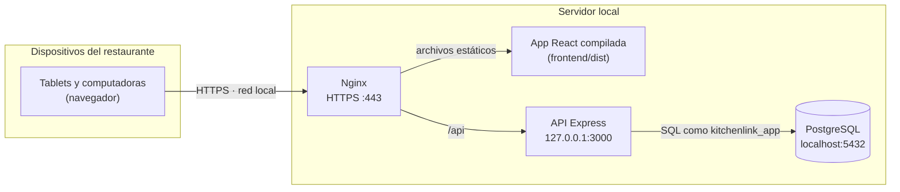
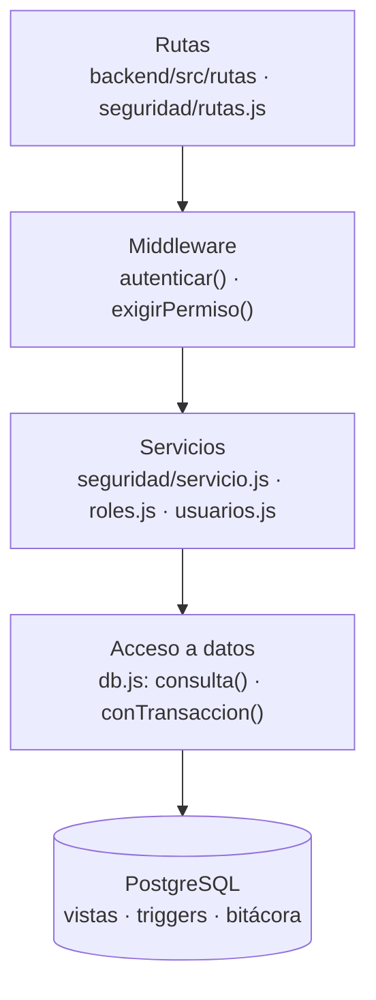
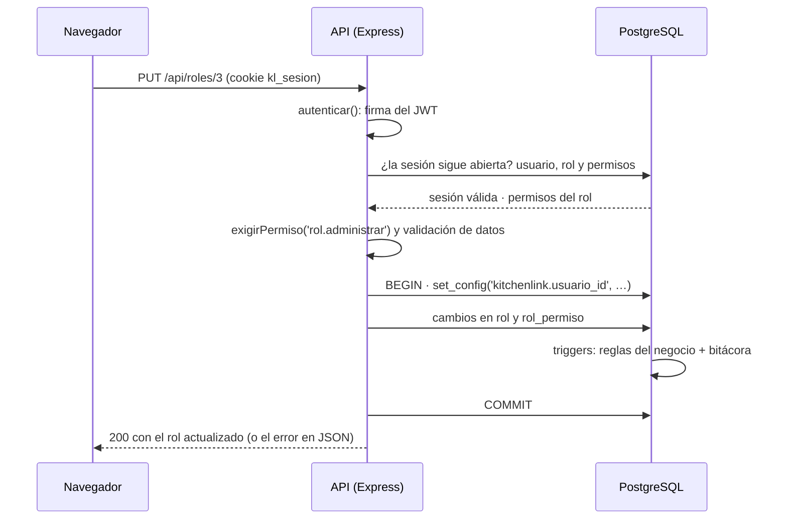

# Arquitectura · KitchenLink

KitchenLink corre completo dentro del restaurante: un servidor en la red local con la aplicación, la API y
la base de datos, y los dispositivos del personal (tablets, pantallas de cocina y computadoras) que la usan
desde el navegador. La operación no depende de internet.

## Despliegue

- **Nginx** entrega la aplicación compilada, redirige HTTP a HTTPS y reenvía `/api` a la API
  ([infra/nginx/kitchenlink.conf](../infra/nginx/kitchenlink.conf)). El certificado lo genera mkcert para la
  red local.
- **La API** escucha solo en `127.0.0.1`: los dispositivos llegan a ella a través de Nginx, nunca
  directamente. En desarrollo, el servidor de Vite hace el mismo papel.
- **PostgreSQL** tampoco se abre a la red: solo la API, en el mismo equipo, se conecta a la base.

## Backend por capas

| Capa | Responsabilidad |
|---|---|
| Rutas | Traducen HTTP a llamadas de servicio. No contienen reglas del negocio. |
| Middleware | `autenticar()` valida la sesión de la cookie; `exigirPermiso()` revisa los permisos del rol. |
| Servicios | Validan los datos de entrada (`validacion.js`) y aplican las reglas propias de la API, como las protecciones del gerente. |
| Acceso a datos | `conTransaccion(usuarioId, …)` abre la transacción y le dice a la base quién opera. |
| Base de datos | Las vistas arman los datos de cada pantalla; los triggers hacen cumplir las reglas y escriben la bitácora. |

Los errores viajan como `ErrorHttp` ([errores.js](../backend/src/errores.js)): un código para el programa y
un mensaje para la pantalla. Los mensajes de los triggers de PostgreSQL se traducen al mismo formato.

## Una petición protegida, paso a paso

1. La cookie `kl_sesion` (`HttpOnly`, `SameSite=Strict`) lleva un JWT firmado con el id de la sesión.
2. La API comprueba la firma y después busca la sesión en la base. Así, cerrar sesión o dar de baja a un
   usuario corta su acceso en la siguiente petición, aunque el JWT no haya vencido.
3. Los permisos se leen de la base en cada petición: un cambio en los permisos de un rol aplica desde la
   siguiente acción de cada usuario.
4. Cada escritura va en una transacción que indica quién opera; los triggers usan ese dato para la
   bitácora y para revisar otra vez los permisos en las operaciones del restaurante.

## Operaciones al mismo tiempo

Varios dispositivos usan el sistema a la vez, así que dos personas pueden cambiar lo mismo en el mismo
instante. PostgreSQL trabaja con su aislamiento por defecto (READ COMMITTED), y el backend usa tres
herramientas según la regla:

| Situación | Cómo se resuelve |
|---|---|
| Dos cambios a la misma fila (dos gerentes guardan el mismo rol) | La fila se bloquea al leerla (`FOR UPDATE` o `FOR NO KEY UPDATE`): el segundo espera y trabaja sobre lo que dejó el primero. |
| Una regla que depende de otra fila (no dar de baja un rol que se está asignando) | Esa fila se bloquea en modo compartido (`FOR SHARE`): nadie la cambia hasta terminar. |
| Una regla que depende de un conteo o de que algo no exista (que quede un Gerente activo, nombres que no se repiten) | Las operaciones se forman en fila con un candado de la transacción (`enFila` en `db.js`): la segunda revisa con lo que la primera ya guardó. |

- La base hace lo mismo en sus triggers: por ejemplo, dos reservaciones para la misma mesa se forman en fila.
- Si aun así la base detiene una operación para evitar un bloqueo mutuo, la API responde `409 REINTENTAR`
  ("Otra persona estaba cambiando lo mismo en ese momento. Vuelve a intentarlo.") y no queda nada a medias.
- El límite de intentos de inicio de sesión cuenta cada intento desde que llega: muchos intentos
  simultáneos no se lo saltan.
- Las pruebas fuerzan estos casos: una conexión de administrador retiene un candado hasta que todas las
  peticiones esperan en la base y luego las suelta juntas (`backend/test/concurrencia.js`).

## Base de datos

- **Esquema v3:** 20 tablas, 22 vistas, 10 tipos ENUM y 27 triggers
  ([database/01_esquema_v3.sql](../database/01_esquema_v3.sql), [diagrama entidad-relación](erd/)).
- **Reglas en la base:** estados válidos, permisos por operación, cortes de caja inmutables. Si alguien se
  salta la aplicación, la base rechaza la operación con un mensaje claro.
- **Rol con permisos mínimos:** la API se conecta como `kitchenlink_app`, que no puede crear ni borrar tablas
  ni modificar la bitácora, los pagos o las cancelaciones ([02_permisos_app.sql](../database/02_permisos_app.sql)).
- **Dinero en `NUMERIC(10,2)`:** nunca en punto flotante. La API lo entrega como texto para no perder
  centavos.
- **Tickets y reportes como vistas:** se calculan a partir de las comandas y los pagos, no se guardan aparte.

## Frontend

- **SPA en React** con React Router. Una sola aplicación para todos los roles: el menú lateral y las pantallas
  se arman con los permisos del rol, no con su nombre, porque los roles se pueden editar.
- **Sesión:** `ContextoSesion` guarda el usuario y sus permisos, y los vuelve a leer al cambiar de
  pantalla. El JavaScript nunca ve el token: viaja solo en la cookie.
- **Sin recursos externos:** la fuente Inter y los íconos van dentro de la aplicación, así que funciona sin
  internet.

## Seguridad

| Medida | Dónde |
|---|---|
| Contraseñas con bcrypt (costo 12), nunca en claro | `seguridad/contrasenas.js` |
| JWT en cookie `HttpOnly` y `SameSite=Strict`; `Secure` con HTTPS | `seguridad/tokens.js` |
| Sesiones revocables (fila en `sesion` con el SHA-256 del secreto) | `seguridad/servicio.js` |
| Mismo mensaje para usuario inexistente y contraseña incorrecta | `seguridad/servicio.js` |
| Límite de intentos fallidos por usuario y por equipo | `seguridad/limitador.js` |
| Permisos en la API y otra vez en la base | `seguridad/middleware.js` · triggers |
| Encabezados de seguridad HTTP (Helmet) | `app.js` |
| Rol de base de datos con permisos mínimos | `database/02_permisos_app.sql` |

## Previsto en el diseño

Piezas de la arquitectura que todavía no forman parte de esta versión:

- **Tiempo real:** avisos instantáneos a cocina, barra y meseros. Nginx ya reserva la ruta `/socket.io/`.
- **Impresión:** tickets, pre-tickets y cortes en la impresora térmica de caja (ESC/POS).
- **Respaldo:** copia nocturna de la base (`pg_dump`) en un disco externo y en la nube. La nube solo guarda
  respaldos y no participa en la operación.
